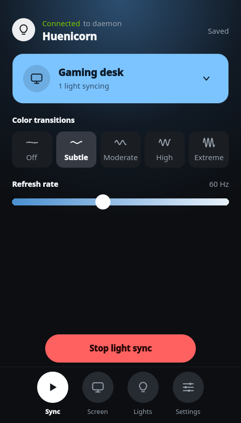
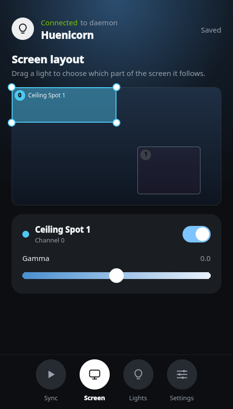
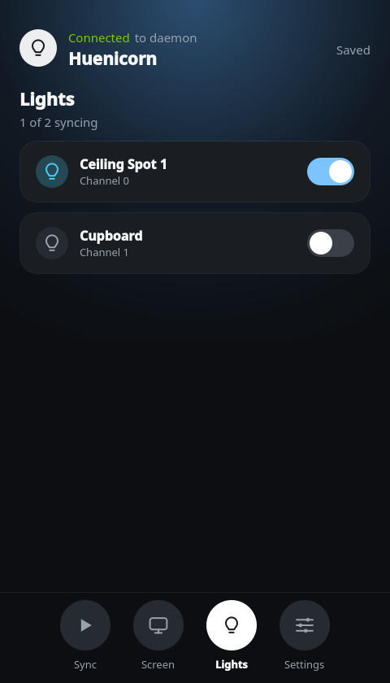
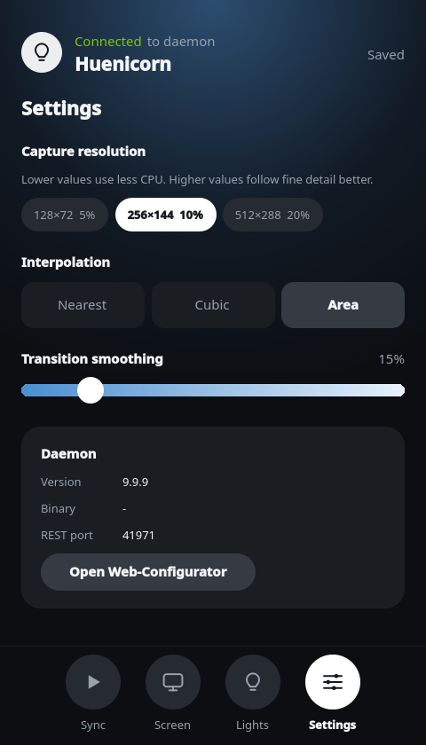

<div align="center">


# Huenicorn GUI

**A native Qt tray app and configurator for [Huenicorn](https://gitlab.com/openjowelsofts/huenicorn), the Philips Hue screen sync for Linux.**

[](https://gitlab.com/openjowelsofts/huenicorn)
[](LICENSE.txt)
[](https://www.qt.io/)

</div>

<p align="center">
  
  
  
  
</p>

> This project is not part of Huenicorn itself. It only talks to the daemon through its REST API, so it has no build
> dependency on it. All credit for the sync engine goes to the
> [Huenicorn authors](https://gitlab.com/openjowelsofts/huenicorn).

## What is this?

[Huenicorn](https://gitlab.com/openjowelsofts/huenicorn) brings Philips Hue screen sync to Linux. It watches your
screen and streams the colors to your Hue lights in real time, so the room glows along with your games, movies and
desktop. It runs as a background daemon and is configured through a web page.

Huenicorn GUI is a more beautiful way to configure it. This native desktop app sits in your system tray, starts the
daemon for you and opens a clean window where you pick your lights, tune the effect and see at a glance whether sync is
running. The web page keeps working alongside it.

## Requirements

- Linux with a system tray (KDE Plasma, or GNOME with an AppIndicator extension)
- [Huenicorn](https://gitlab.com/openjowelsofts/huenicorn), or the build tools to let the app build it (see below)
- Qt 6 (Widgets, Network, Quick, plus the Linguist tools to build the translations), CMake 3.16 or newer and a C++20 compiler to build

Install the build requirements for your distribution:

**Debian, Ubuntu**

```sh
sudo apt install build-essential cmake libgl1-mesa-dev qt6-base-dev qt6-declarative-dev qt6-tools-dev qt6-l10n-tools \
  qml6-module-qtquick qml6-module-qtquick-window qml6-module-qtqml-workerscript
```

**Fedora, RHEL, AlmaLinux, Rocky (dnf or yum)**

```sh
sudo dnf install gcc-c++ cmake qt6-qtbase-devel qt6-qtdeclarative-devel qt6-qttools-devel
```

On RHEL 9 and its clones, Qt 6 comes from EPEL, so enable that repository first.

**Arch, Manjaro**

```sh
sudo pacman -S --needed base-devel cmake qt6-base qt6-declarative qt6-tools
```

## Build and run

```sh
cmake -S . -B build
cmake --build build
ctest --test-dir build
build/huenicorn-qt
```

The daemon's REST port is read from `~/.config/huenicorn/config.json`. The app finds the `huenicorn` binary through its
settings, next to its own binary, or on your `PATH`.

### Installing the daemon from the app

If no daemon is found, the app offers to build Huenicorn from source. If build dependencies are missing, it lists tehm with the install command for your distribution.

The build is pinned to one daemon version. The app checks that the downloaded source is the exact expected commit and
verifies the checksum of the three small libraries the daemon would otherwise fetch unchecked. It builds in a
temporary directory and installs to `~/.local/bin/huenicorn`. Needs git, cmake, a C++ compiler, tar, xz, pkg-config and
the development files of libcurl, OpenCV, Mbed TLS 3 or newer, plus X11 or PipeWire and GLib depending on your session.

## Using it

| Action | How |
| --- | --- |
| Open the configurator | Left click on the tray icon |
| Start, stop, restart the daemon | Tray menu |
| Open the browser configurator | Tray menu, or *Open Web-Configurator* in the Settings tab |
| Change autostart, daemon path, quit behavior | Tray menu, *Settings* |

## Translations

English and German ship with the app. The language follows your system, or you can pick one under Settings, Language. The change applies right away.

Each language is one file in `translations/`, named `huenicorn-qt_<code>.ts`. To add a language:

```sh
cp translations/huenicorn-qt_en.ts translations/huenicorn-qt_fr.ts
# change language="en" to language="fr" in the new file, then
cmake -S . -B build
cmake --build build --target update_translations
linguist-qt6 translations/huenicorn-qt_fr.ts
```

Reconfigure once so the build picks up the new file, then translate it in Qt Linguist or any text editor. Untranslated strings
show in English. Keep placeholders like `%1` in every translation, the test suite checks this. Run `update_translations` after
changing any user visible text in the code. Strings in the `.ts` files are grouped by class or QML file name.

## Credits

Huenicorn GUI is a companion to [Huenicorn](https://gitlab.com/openjowelsofts/huenicorn) by
[openjowelsofts](https://gitlab.com/openjowelsofts).

## Releases

Versions are managed by [release-please](https://github.com/googleapis/release-please) from Conventional Commit messages on `master`. It keeps a release PR open that bumps the version in `CMakeLists.txt`. Merging it creates the `vX.Y.Z` tag and the GitHub release, and the tag builds and tests the packages and attaches them with a `SHA256SUMS` file and a build provenance attestation:

    huenicorn-qt-X.Y.Z-fedora.rpm
    huenicorn-qt-X.Y.Z-ubuntu-24.04.deb
    huenicorn-qt-X.Y.Z-debian-13.deb
    huenicorn-qt-X.Y.Z-arch.pkg.tar.zst
    huenicorn-qt-X.Y.Z-linux-x86_64.tar.gz

Build a package locally with `cpack -G RPM` (or `DEB`, `TGZ`) in the build directory. The Arch package is built from `packaging/arch/PKGBUILD`.

## License

GPLv3, see [LICENSE.txt](LICENSE.txt).
